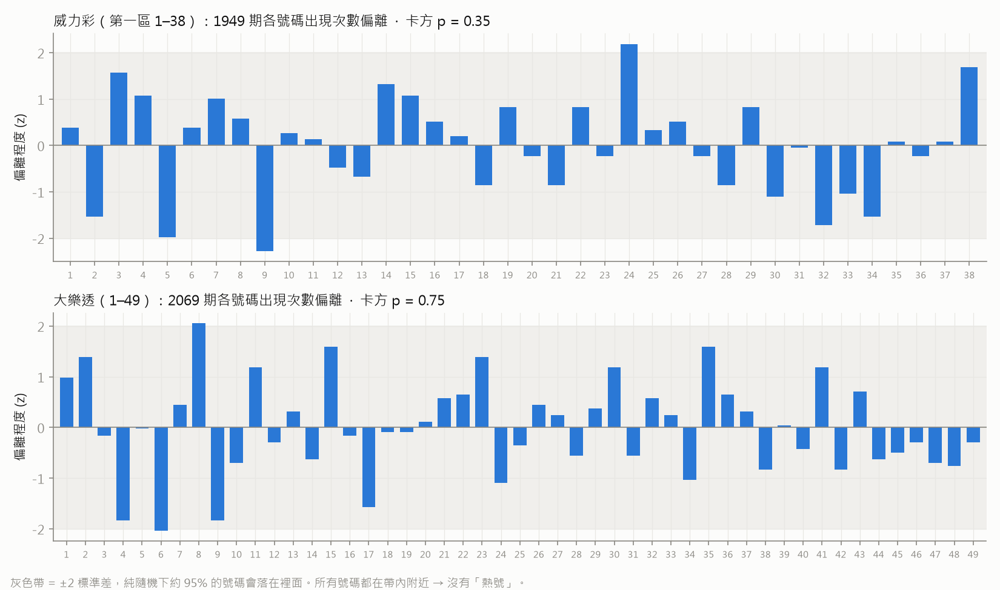
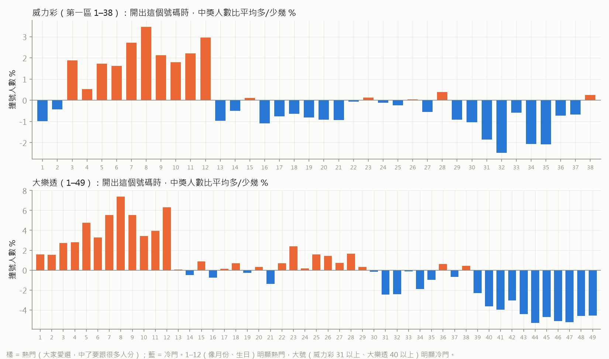
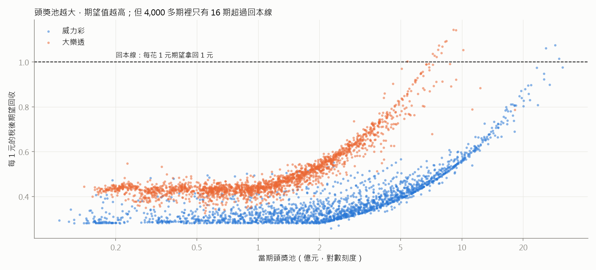

# 威力彩與大樂透研究

[← 回總覽與決策劇本](../README.md)

資料：台灣彩券官方 API，2008-01 至 2026-09-25。威力彩 1,949 期、大樂透 2,069 期，每期都有號碼、銷售額、各獎中獎人數與獎金。

## 結論

**沒有任何方法能提高中獎機率**：4,000 多期開獎在統計上跟完全隨機無法區分，機器學習回測也全部輸給或等於亂猜。
**但有兩個方法能提高「中了能拿多少」**，這是唯一真的有數據支持的「奇技淫巧」：

1. **選冷門號碼**：大家愛選 1–12（生日、月份），很少選大號。中頭獎時，最熱門組合平均要跟 **3 倍**的人分，最冷門組合只要 **0.35 倍**（大樂透）。
2. **只在頭獎池特別大時買**：平常每花 1 元，稅後期望只拿回 0.38 元（威力彩）或 0.50 元（大樂透）。頭獎池超過約 **22 億（威力彩）／6.5–10 億（大樂透）** 時，期望值才會超過本金。18 年來只出現過 16 期。

就算期望值超過本金，你幾乎一定還是會輸掉買彩券的錢（中頭獎機率約 1/1,400 萬～1/2,200 萬）。這只是讓「買彩券」這件事從很虧變成沒那麼虧。

---

## 1. 規則速覽

完整規則、獎金表、稅、歷年改制與來源網址見 [rules.md](rules.md)。

| | 威力彩 | 大樂透 |
|---|---|---|
| 玩法 | 第一區 1–38 選 6 ＋ 第二區 1–8 選 1 | 1–49 選 6（另開 1 個特別號） |
| 每注 | 100 元 | 50 元 |
| 開獎 | 每週一、四 | 每週二、五 |
| 頭獎機率 | 1 / 22,085,448 | 1 / 13,983,816 |
| 任何獎機率 | 約 1 / 8.5 | 約 1 / 32 |
| 獎金支出率 | 55% | 56% |
| 頭獎保底（有人中時） | 2 億 | 1 億 |
| 稅 | 單筆 > 5,000 元扣 20% 所得稅＋0.4% 印花稅，實拿 79.6% | 同左 |

**同樣花 100 元**：大樂透買 2 注中頭獎機率 1/699 萬，威力彩 1 注 1/2,209 萬，**大樂透高 3.2 倍**；平均回收也較高（0.50 vs 0.38）。威力彩的賣點只是頭獎池比較容易滾大。

用官方開獎資料核對規則改制日期與歷史頭獎的結果，已併入 [rules.md](rules.md)。

## 2. 開獎號碼是隨機的嗎？

檢定程式：[src/lottery/analysis.py](../src/lottery/analysis.py)。p 值越小越可疑，通常 < 0.05 才算「可能有偏差」。

| 檢定 | 威力彩 p | 大樂透 p | 白話 |
|---|---|---|---|
| 各號碼出現次數是否平均（卡方） | 0.35 | 0.75 | 平均 |
| 每約 4.5 年分一段，各段是否平均 | 0.15 / 0.53 / 0.60 / 0.20 | 0.16 / 0.40 / 0.99 / 0.67 | 沒有哪段時期開獎機偏心 |
| 第二區／特別號是否平均 | 0.26 | 0.035 | 大樂透特別號偏低，但做了十幾個檢定，碰巧出現一個 < 0.05 很正常（校正後不顯著） |
| 跟上一期重複幾個號碼 | 0.95 | 0.17 | 符合純隨機 |
| 六個號碼加總的分布 | 0.72 | 0.89 | 符合純隨機 |
| 出現連號的比例 | 0.39 | 0.24 | 符合純隨機 |
| 奇偶數比例 | 0.93 | 0.65 | 符合純隨機 |

「熱號會延續嗎？」上期開出的號碼，本期再開出的比率：威力彩 15.6%（沒開出的 15.8%，理論 15.8%）；大樂透 12.3%（理論 12.2%）。**完全沒有延續性**。



## 3. 機器學習能預測嗎？

（由 Codex 子代理獨立實作 walk-forward 回測，程式 [src/lottery/ml_backtest.py](../src/lottery/ml_backtest.py)，完整結果 [output/ml_results.md](../output/ml_results.md)）

做法：用前 500 期當起始資料，之後每一期只用「當時已知」的歷史去預測下一期（每 50 期重新訓練），每種策略每期買 1 注，共回測約 1,500 期。比較 9 種策略：純隨機、熱號（近 10／30／100 期）、冷號（最久沒開、近 100 期最少）、每個號碼各訓練一個 Logistic 迴歸與 LightGBM 模型（特徵：近 5／10／30／100 期出現頻率、遺漏期數、歷史頻率、近 10 期是否出現）、以及看最近 10 期的 MLP 神經網路。

| 平均每注命中幾個主號 | 威力彩（理論 0.947） | 大樂透（理論 0.735） |
|---|---|---|
| 純隨機 | 0.930 | 0.730 |
| 熱號 30 期 | 0.954 | 0.722 |
| 冷號（近 100 期最少） | 0.937 | 0.765 |
| Logistic | 0.965 | 0.708 |
| LightGBM | 0.930 | 0.718 |
| MLP 神經網路 | 0.947 | 0.717 |

- 所有策略都在理論值附近上下亂跳，**45 個檢定做多重比較校正後，沒有一個顯著**（校正後 p 全部 = 1）。表現最好的「大樂透冷號」原始 p = 0.06，連未校正都不顯著，換一段資料就會換別的策略當第一。
- 更關鍵的證據：所有模型給每個號碼的「出現機率」，準確度（log-loss、Brier）**全部比直接猜「每個號碼機率都一樣」還差**。模型學到的只是雜訊。
- 結論：開獎號碼沒有可學的規律，機器學習在這裡等於花很多電腦時間做亂猜。

## 4. 真正有效的技巧一：選別人不選的號碼

**原理**：中獎機率每組號碼都一樣，但頭獎是「所有中的人平分」。如果你選的號碼很多人也選，中了就要跟一堆人分。

**怎麼量出大家愛選哪些號**：官方公布每期每個獎有多少人中。假如某期開出的號碼剛好是大家愛選的，那一期「中 3 個號碼」的人就會比純隨機預期的多。拿 2,000 多期的「實際中獎人數 ÷ 預期人數」去回推，就能算出每個號碼的熱門程度。



- **熱門**：1–12，尤其 7、8、9、12（月份、生日、幸運數字）。
- **冷門**：威力彩 31–35；大樂透 40–49。
- 這個熱門度是**穩定、可預測的**（跟開獎號碼相反）：用前半段資料學到的熱門度，預測後半段的準確度 R² = 0.31（威力彩）／0.56（大樂透）；拿去預測完全沒用來訓練的「中 5 個號碼的人數」，相關係數 0.37／0.49（p < 10⁻⁶⁴）。
- **頭獎實證**：把大樂透 2,069 期依「開出號碼的熱門度」分四組，最熱門那組實際頭獎中獎注數 157 注（純隨機預期 112），最冷門那組 90 注（預期 109）。

| 同一期中頭獎時，平均要跟幾倍的人分 | 威力彩 | 大樂透 |
|---|---|---|
| 最冷門組合 | 0.64 倍（16 30 31 32 34 35） | 0.35 倍（44–49） |
| 隨機電腦選號 | 約 1.0 倍 | 約 1.0 倍 |
| 最熱門組合 | 2.07 倍（3 7 8 9 11 12） | 3.08 倍（5 7 8 9 11 12） |

注意：上表「最冷門」是模型只看單一號碼算出來的。實際上 44 45 46 47 48 49 這種**連號、等差、同一排**的圖案，很多人會故意買，反而會撞號。所以選號時要：**用大號、但打散，避開圖案、避開上期號碼、避開網路明牌**。

選號小工具（隨機產生、偏冷門、排除圖案；每次結果不同，避免大家都算出同一組）：

```
python src/lottery/pick.py lotto 5     # 大樂透 5 注
python src/lottery/pick.py power 5     # 威力彩 5 注
```

台彩公布的億元頭獎中獎彩券約七成是電腦選號，那只是因為買的人約七成用電腦選號，**不代表電腦選號比較會中**。電腦選號的好處是天生不偏熱門，自選如果偏向生日號就比電腦選號更差。

## 5. 真正有效的技巧二：看頭獎池大小決定買不買

每注期望值 = Σ（各獎機率 × 該獎實拿金額）。頭獎、貳獎是彩池平分：若當期賣出 N 注，同號的人數大約是 Poisson 分布，你分到的比例平均為 (1 − e^−λ)/λ，λ = N × 頭獎機率。另外納入頭獎保底與稅。



| | 威力彩 | 大樂透 |
|---|---|---|
| 每花 1 元，平均稅後拿回 | 0.38 元 | 0.50 元 |
| 歷史最高期 | 1.075 元（2015-09-14，頭獎池 28.7 億） | 1.143 元（2026-07-28，頭獎池 9.1 億） |
| 稅後期望 ≥ 1 的期數 | 3 / 1,949 期 | 13 / 2,069 期 |
| 若選冷門組合，≥ 1 的期數 | 8 期 | 44 期 |
| 頭獎池要多大才回本（銷售量一般 → 暴增 6 倍） | 約 21.8 → 23.4 億 | 約 6.4 → 9.7 億 |

頭獎池越大，跟風買的人越多，撞號也越多，所以回本門檻會隨銷售量往上移。

另外：春節、端午等**加碼活動**（大紅包、頭獎加碼 2 億）會額外灌獎金進來，期望值也會明顯提高；官方 API 沒有包含加碼獎，本分析未計入。春節大紅包的估算見第 7 節。

## 6. 其他常見說法，一次講清楚

| 說法 | 真相 |
|---|---|
| 熱號會繼續開、冷號快要開了 | 錯。上期開出與否對下期毫無影響（第 2 節）。開獎機沒有記憶。 |
| 包牌比較容易中 | 包牌只是一次買很多注，機率＝注數 ÷ 總組合數，每元期望值完全不變。第二區 8 碼全包（800 元）只是保證第二區中，不會變划算。 |
| 同一組號碼連買比較會中 | 錯。每期獨立。 |
| AI／明牌／預測軟體 | 本研究的 ML 回測顯示無效；賣明牌的若真有效不會拿來賣。 |
| 合資買 | 不改變期望值，只是分散風險、多人一起開心；中了要注意贈與稅問題（事先寫好合資紀錄）。 |
| 大樂透 vs 威力彩 | 同樣的錢，大樂透中頭獎機率高 3.2 倍、平均回收較高；威力彩頭獎較容易滾到 20 億以上。 |

## 7. 其他可能性（補充研究）

| 方向 | 結果 |
|---|---|
| **春節大紅包加碼** | 2026 年春節連開 20 天。每期另開 9 個「大紅包號碼」：你的 6 個號碼全在這 9 個裡面，就能分 100 萬；有 5 個在裡面、再中 1 個「小紅包號碼」，就能分 10 萬。同一注自動對獎，不用另外付錢。以當期實際銷售額 2–3.3 億估算，**每注稅後多拿回約 9–10%**（冷門號約 10.5%），但總回收大約只從 0.50 變成 0.60，還是虧錢。它跟頭獎池無關，所以是一般人最容易吃到的加碼。大紅包 480 組發完活動就提前結束，前幾天買最划算。 |
| **威力彩第二區也有冷熱** | 用「中 3 個號碼時，第二區有中的人數 ÷ 沒中的人數」反推，1,675 期的結果：**1 號最少人選（比平均少 6%）**，5 號最多人選（比平均多 4%）。前後兩半的資料方向一致，但差距很小，選 1 號最多只少跟 6% 的人分獎，實際影響可以忽略。 |
| **全包所有組合** | 大樂透全包要 6.99 億元，威力彩要 22.1 億元。只有頭獎池超過第 5 節的回本線時帳面上才划算，但要在開獎前印出 1,400 萬到 2,200 萬張彩券，實際上做不到。1992 年美國維吉尼亞州有人這樣做過，之後各國都限制了投注機一次能下的注數。 |
| **開獎機、球組偏差** | 號碼頻率檢定 p 值是 0.35 和 0.75（第 2 節），看不到任何偏差。API 沒提供每期用哪台機器、哪組球，沒辦法再細分。 |

